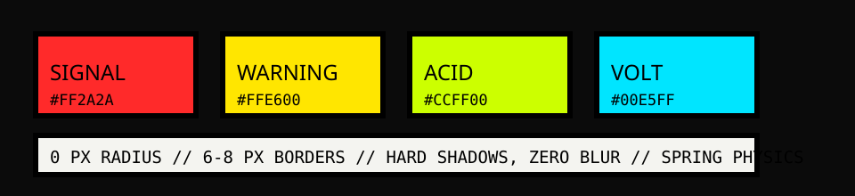

# Neobrutalist Reels Edit

A Claude Code skill that turns **raw footage + one voiceover file** into a finished
**1080x1920 / 60fps** vertical edit where every sentence lands on the shot that shows what it
says - with a consistent Tactical Neobrutalism design system and an audio master that is
measured, not guessed.

Built on [Remotion](https://remotion.dev) (React motion graphics), ffmpeg and local
word-level ASR. No cloud editor, no subscription, no manual timeline.



## What it does

| Step | Tool |
|---|---|
| Index every clip, find the hero seconds | `scripts/contact_sheets.py` |
| Word-level transcript of the voiceover | `scripts/transcribe.py` (faster-whisper) |
| Subtitle blocks locked to those words | `scripts/build_subtitles.py` |
| Cut hero clips at a uniform format | `scripts/cut_clips.py` |
| Compose scenes with a motion-graphics kit | `template/` (Remotion) |
| Catch blocks that outrun their clip | `scripts/check_overruns.py` |
| CC0 sound effects, normalised | `scripts/fetch_sfx.py` |
| Voiceover + SFX + optional music master | `scripts/mix_audio.py` |
| Verify loudness, black and frozen frames | `scripts/verify_edit.py` |

## The design system

Tactical Neobrutalism: **0 px radius, 6-8 px black borders, hard shadows with zero blur**,
signal red `#FF2A2A`, warning yellow `#FFE600`, acid green `#CCFF00`, high-voltage blue
`#00E5FF` on black and concrete `#F4F4F0`. Spring physics, never linear fades. Cross-dissolves
are banned.

### Component kit (`template/src/components/`)

- **`Clip`** - the windowed shot. A 1920 px source is shown 1040 px wide (a *downscale*, so it
  stays sharp) inside a bordered window, over a blurred copy of itself. This is the fix for the
  usual vertical-edit problem: cropping 16:9 into 9:16 upscales 1.78x, softens the picture and
  throws away 70% of the frame.
- **`Graphics`** - `BrutalCard`, `GiantQ` (the giant question mark), `CrossOut`, `SpeedCounter`,
  `TargetBox`, `WarnBand`, `HudFrame`, `EmpRings`, `CloneSwarm`, `HyperCollage`, `SplitBar`.
- **`Fx`** - grain, grid texture, impact frames, flashes, camera shake, RGB split, glitch slices.
- **`Subtitles`** - single line, auto-fitted to the frame, Turkish-correct uppercase
  (`İ` vs `I`), accent words in yellow, spring pop-in.
- **`Chrome`** - broadcast chrome: corner ticks, hairlines, slate tag, running timecode.

## Install

```bash
git clone https://github.com/EmirhanYAZICI/neobrutalist-reels-edit \
  ~/.claude/skills/neobrutalist-reels-edit
```

Claude Code picks the skill up automatically. Then just ask, in any language:

> "Bu klasördeki videolarla ses kaydına göre dikey bir kurgu yap"
> "Make a vertical Reels edit from this footage and voiceover"

Requirements: Node 18+, ffmpeg on PATH, Python 3.9+, and `pip install faster-whisper` for the
transcription step.

## Hard rules the skill enforces

1. No random clip placement - every shot answers the sentence spoken over it.
2. Never upscale into the 9:16 frame; window the source instead.
3. `block_frames * speed / 60 + clip_from <= clip_duration`, checked automatically.
4. Turkish uppercase needs an explicit `i -> İ` pass, not CSS `text-transform`.
5. Audio is measured: SFX at -3 dBTP, music at -20 LUFS and ducked, master -16 LUFS / -4.5 dBTP.
6. CC0 audio by default - "non-commercial" does not waive CC BY attribution.

## Documentation

- [`SKILL.md`](SKILL.md) - the pipeline Claude follows
- [`references/layout.md`](references/layout.md) - the 1080x1920 grid and safe zones
- [`references/pacing.md`](references/pacing.md) - shot lengths, speed ramps, impact grammar
- [`references/audio.md`](references/audio.md) - loudness targets, cue map, licensing
- [`references/qa-checklist.md`](references/qa-checklist.md) - what to verify before export

## License

MIT. The template ships no media: bring your own footage, voiceover and logo.
